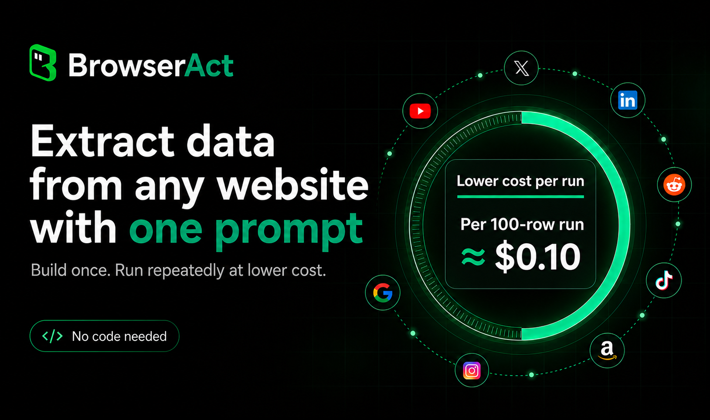

# Browser Act
Browser automation agent toolkit.

  
    
  

    
    
    
      
    
    
    
    
  

---

## What can BrowserAct be used for?

BrowserAct enables AI agents and teams to perform real-browser automation, web data extraction, and account-based workflows.

It helps agents get past anti-bot walls, hand off to humans across platforms when stuck, run parallel tasks without cross-contamination, and isolate multiple accounts in independent browsers, backed by stealth fingerprints, TLS rotation, residential proxies, CAPTCHA solving, and stable fingerprint-proxy setups for authenticated sessions.

Two usage modes are available: fully cloud-managed execution, or local browser control driven by your own agent workflow.

### Use [BrowserAct](https://www.browseract.com/?co-from=github) in the cloud

**No agent setup required, with lower operating cost.** Describe the website, filters, and fields you need. BrowserAct builds and tests a reusable scraping Bot in a real cloud browser, then runs it from the cloud. **Build once. Run reliably. Improve continuously.**

[Start from BrowserAct Cloud →](https://www.browseract.com/?co-from=github)

**Watch demo:** [Build a Web Scraper from One Prompt | BrowserAct →](https://www.youtube.com/watch?v=1M11lfNW7rE)

### Use BrowserAct locally with Skills

Use BrowserAct Skills when you want local browser control, local Chrome login-state reuse, or direct integration into your own AI agent workflow.

Your agent can load the BrowserAct Skill, discover browser state with `get-skills`, and run browser automation commands directly from your local environment.

**Watch demo:** [BrowserAct: Give AI Agents a Real Browser →](https://www.youtube.com/watch?v=sTUD4drYYrk)

[Start from BrowserAct Skills →](#install)

## Why BrowserAct

The browser an AI agent needs has to reach places standard tools can't, let a human seamlessly take over when the agent is stuck, keep parallel tasks from cross-contaminating, and be designed for LLM reasoning — not human-written scripts. **A browser for agents must get four things right.**

**1. Break through blocks — three progressive layers**

1. **Environment layer** — stealth fingerprint spoofing, TLS rotation, proxy switching. The vast majority of blocks never trigger.
2. **Execution layer** — `solve-captcha` auto-solves CAPTCHAs; `stealth-extract` pulls protected pages in one command.
3. **Human layer** — `remote-assist` generates a live URL; the user takes over from any device, and the agent continues seamlessly when done.

**2. Three browser modes — by real-world scenario**

| Mode | Scenario | Key trait |
|------|----------|-----------|
| `chrome` | Reuse local Chrome login state | Profile import or CDP attach |
| `stealth` privacy mode | Frictionless batch scraping without login | Fresh fingerprint per session + proxy rotation, zero residue |
| `stealth` fixed identity | Logged-in accounts · multi-browser parallel | Stable fingerprint + stable IP, stable account identity, not flagged as bots |

**3. Zero-interference concurrency — every agent in its own lane**

- Cross-browser parallel — independent cookies, fingerprints, proxies. Sites cannot correlate them.
- Same-browser multi-session — shared login state, independent execution, tasks don't block each other.
- Privacy mode — fresh fingerprint and empty profile per session, zero residue when done.

**4. Designed for agent reasoning — not human scripts**

- **Compact text output